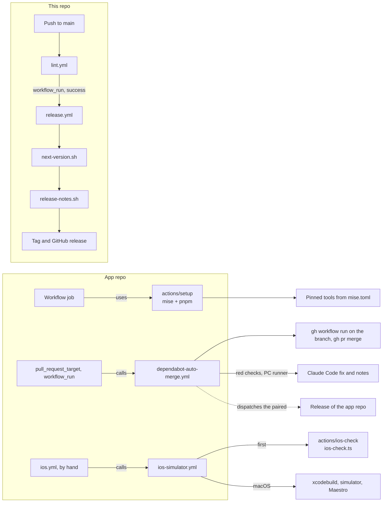

# Architecture

A composite action and a reusable workflow. App repos call them from their own workflows. This repo's own pushes get a lint and a release.

| Part       | Technology                    | Job                                                             |
| ---------- | ----------------------------- | --------------------------------------------------------------- |
| Setup      | GitHub composite action, mise | Same tools in every repo                                        |
| Auto merge | Reusable workflow, `gh` CLI   | Tests, fixes and merges Dependabot PRs                          |
| iOS check  | `ios-check.ts`, Node          | Lists Android only pieces with no iOS plan                      |
| iOS build  | Reusable workflow, ios-vm     | Simulator build, Maestro flows, screenshots                     |
| Lint       | `lint.yml`                    | Checks this repo's own files                                    |
| Release    | `release.yml`, shell          | Tags each push to main that passes Lint and publishes its notes |
| Affected   | `affected.ts`, Node, pnpm     | Says which products a push changed, from git and the pnpm graph |
| Test       | `test-release.sh`, sh and git | Checks the two release scripts in a throwaway repo              |

## Shared formats

Two scripts share two formats, and `mise run test` keeps them in step.

- **Tag** `v<yyyy.mm.dd>.<n>`. `next-version.sh` prints the date and the count, `release.yml` adds the `v`, and `release-notes.sh` finds the last one with `v[0-9]*.[0-9]*.[0-9]*`.
- **Commit subject** `type(scope)!: text`. `release-notes.sh` sorts `feat`, `fix` and `perf` into sections and drops the type from the note.
- **Templates** both scripts match the `repo-ci` templates in `agent-skills-private`. A fix lands in both, or the next repo gets the old script.

## Decisions

### Shared steps: one repo that every app repo calls

- **Picked** `actions/setup` and `dependabot-auto-merge.yml` sit here. Each
  app repo calls them from its own workflows.
- **Why** the app repos copied the same CI steps by hand, and the copies
  drifted.
- **Trade-off** a bad merge here breaks the CI of every caller on its next
  run.
- **Rejected**
  - **A copy per repo** the copies drifted.
  - **A template repo** it copies the files once at creation, so later fixes
    don't reach the repos.
- **Cost to undo** high. Each repo gets the steps back in its own workflows.

### Version: callers use `@main`

- **Picked** the app repos call `@main`, so a merge here reaches each repo on
  its next run.
- **Why** one fix lands everywhere without a PR per repo.
- **Trade-off** a caller can't hold back a change. A repo that needs to pins a
  release tag in place of `@main`.
- **Rejected**
  - **A pinned tag or SHA per caller** each fix then needs a bump in every
    repo, the drift the shared repo came to stop.
- **Cost to undo** medium. Each caller's `uses:` line changes.

### Setup step: a composite action over mise

- **Picked** `actions/setup` is a composite action. It runs
  `jdx/mise-action` for the tools in `mise.toml`, with shims under the
  runner's temporary directory, then
  `pnpm install --frozen-lockfile`, with a copy from `C:ci_pnpm-store` on
  Windows.
- **Why copy** on the PC every hardlink of a store file shares one file, and
  a delete of any link fails reads through the others with `EBUSY`. The
  runners' own store gets no links from dev clones or old checkouts.
- **Why** a running process on a self-hosted runner can hold the shared
  `uvx.exe` shim open. A job-local shim path lets mise update its tools without
  renaming that shared executable.
- **Why** a composite action runs inside the caller's job, so the caller adds
  its own checks after it. The org rule pins every tool in `mise.toml`.
- **Trade-off** a repo whose tools mise can't install needs its own steps; a
  job recreates its small shim directory while tool installs stay shared.
- **Rejected**
  - **A reusable workflow for setup** it is a whole job, so the caller's
    steps can't follow it in the same job.
  - **`actions/setup-node` and friends** each pins a version apart from
    `mise.toml`, and each runner downloads its own copy.
- **Cost to undo** medium. Each caller's setup steps change.

### Dependabot: test the branch, then merge

- **Picked** on `pull_request_target` the job starts the listed `workflows`
  on the Dependabot branch. Their `workflow_run` merges the PR once each one
  passed on its head, then starts them on `main`. A red branch goes to
  Claude Code on the PC runner for 2 fix tries.
- **Why** the merge on open put each bad update on `main`, and the next
  build there failed.
- **Trade-off** a merge waits for the checks, and each caller listens to
  `workflow_run` too. Claude runs under the subscription of the PC login.
- **Rejected**
  - **Merge on open** a bad update broke `main` until a person fixed it.
  - **GitHub auto merge** it needs required checks, and the Free plan has no
    branch rules on private repos.
  - **GitHub Models** `actions/ai-inference` v3 calls the Copilot CLI, which
    needs a paid seat.
- **Cost to undo** medium. Each caller loses its `workflow_run` trigger.

### Merge guard: Dependabot opened it and made the event

- **Picked** the job tests only when `dependabot[bot]` opened the PR and is
  the actor. It merges only when each commit comes from Dependabot or the fix
  job. A run that finds the PR merged or closed stops.
- **Why** a commit a person pushed to a Dependabot branch merged with no
  review. A second run for a merged PR started the checks again.
- **Trade-off** a person who fixes a Dependabot PR merges it by hand.
- **Rejected**
  - **Any actor on a Dependabot branch** it let the unreviewed commit in.
- **Cost to undo** low. The `if:` line of the job.

### Access: a public repo

- **Picked** the repo is public since 2026-11-18. Its own Lint and Release
  run on `ubuntu-latest`.
- **Why** GitHub shares actions of a private repo with private repos only, so
  agent-skills, gh-review-notify, git-aliases and vscode-open-in-github
  couldn't load `actions/affected`. The repo holds secret names, no values.
- **Trade-off** the org's CI setup is public, and the PC runner group refuses
  public repos, so the repo's own jobs use GitHub runners.
- **Rejected**
  - **Private, open to the org** the public repos fail to load the actions.
  - **A second public repo for the actions** two places to keep in step.
  - **A copy of the step in each public repo** the copies drift.
- **Cost to undo** low. One setting, and the two `runs-on` lines.

### Releases: a date tag after each green Lint

- **Picked** `release.yml` starts on `workflow_run` once Lint passes on a
  push to `main`, so no job holds a runner while it waits. It tags that
  commit, such as `v2026.10.30.1`.
- **Why** the org rule gives every repo a release with a date version. A
  merge left no tagged point to go back to.
- **Trade-off** the tag gives the date only, with no size of the change. A push of
  Markdown only skips Lint, so it gets no release.
- **Rejected**
  - **Semver tags** the callers read `@main` and skip the version
    number.
- **Cost to undo** low. `release.yml` and its two scripts.

### iOS check: a script here, run from the clone or the action

- **Picked** `scripts/ios-check.ts` runs straight in Node 24, which strips the types. On the PC the app's mise task runs it from the `ci` clone. In CI `actions/ios-check` runs it from the action's own copy of this repo.
- **Why** GitHub downloads the whole repo for a composite action, so the private repo needs no token and no extra checkout.
- **Trade-off** the PC runs the clone's version, so a stale clone checks with an older list.
- **Rejected**
  - **An npm package** it needs a registry and a version bump per list change.
  - **A checkout of this repo in the job** the job token of an app repo can't read another private repo.
- **Cost to undo** low. One script and one action.

### iOS build: a reusable workflow on the ios-vm runner

- **Picked** `ios-simulator.yml` runs on `[self-hosted, ios-vm]`, a Tart macOS VM on the owner's work Mac, after `ios-check` passes on `CI_RUNNER`. With `upload: true` it also signs and uploads to App Store Connect through `actions/ios-upload`.
- **Why** the PC runners are Windows, and a GitHub macOS minute counts as 10 on a private repo.
- **Trade-off** one VM runs one job at a time, and the work Mac has to be on. `CI_IOS_RUNNER` moves the job back to `macos-latest`.
- **Signing** manual signing on the app target with a profile from the API. Automatic signing needs a development profile for the archive, and the team has no registered device.
- **Rejected**
  - **EAS Build** its free plan caps iOS builds, and Maestro still needs a Mac.
- **Cost to undo** medium. Each caller's `ios.yml` changes.
