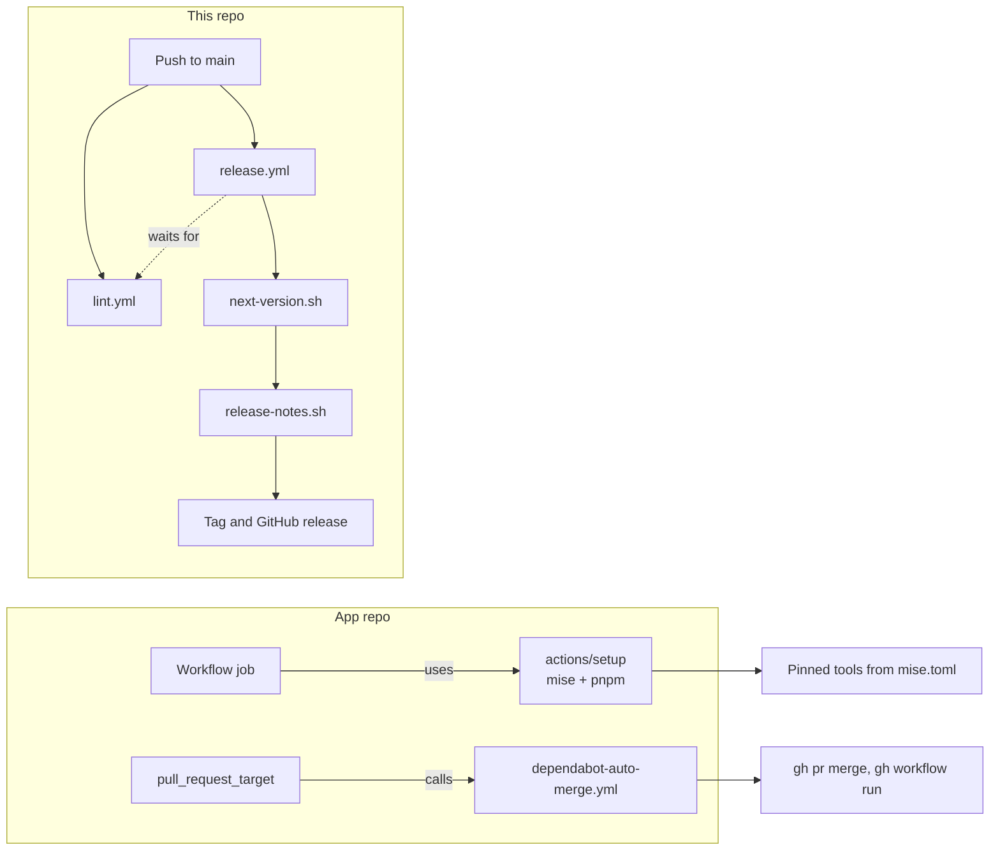

# Architecture

A composite action and a reusable workflow. App repos call them from their own workflows. This repo's own pushes get a lint and a release.

| Part       | Technology                    | Job                                                             |
| ---------- | ----------------------------- | --------------------------------------------------------------- |
| Setup      | GitHub composite action, mise | Same tools in every repo                                        |
| Auto merge | Reusable workflow, `gh` CLI   | Merges Dependabot PRs                                           |
| Lint       | `lint.yml`                    | Checks this repo's own files                                    |
| Release    | `release.yml`, shell          | Tags each push to main that passes Lint and publishes its notes |
| Test       | `test-release.sh`, sh and git | Checks the two release scripts in a throwaway repo              |

## Shared formats

Two scripts share two formats, and `mise run test` keeps them in step.

- **Tag** `v<yyyy.mm.dd>.<n>`. `next-version.sh` prints the date and the count, `release.yml` adds the `v`, and `release-notes.sh` finds the last one with `v[0-9]*.[0-9]*.[0-9]*`.
- **Commit subject** `type(scope)!: text`. `release-notes.sh` sorts `feat`, `fix` and `perf` into sections and drops the type from the note.
- **Templates** both scripts match the `repo-ci` templates in `agent-skills-private`. A fix lands in both, or the next repo gets the old script.

## Decisions

### Shared steps: one repo that every app repo calls

- **Picked** `actions/setup` and `dependabot-auto-merge.yml` sit here. Each
  app repo calls them from its own workflows.
- **Why** the app repos copied the same CI steps by hand, and the copies
  drifted.
- **Trade-off** a bad merge here breaks the CI of every caller on its next
  run.
- **Rejected**
  - **A copy per repo** the copies drifted.
  - **A template repo** it copies the files once at creation, so later fixes
    don't reach the repos.
- **Cost to undo** high. Each repo gets the steps back in its own workflows.

### Version: callers use `@main`

- **Picked** the app repos call `@main`, so a merge here reaches each repo on
  its next run.
- **Why** one fix lands everywhere without a PR per repo.
- **Trade-off** a caller can't hold back a change. A repo that needs to pins a
  release tag in place of `@main`.
- **Rejected**
  - **A pinned tag or SHA per caller** each fix then needs a bump in every
    repo, the drift the shared repo came to stop.
- **Cost to undo** medium. Each caller's `uses:` line changes.

### Setup step: a composite action over mise

- **Picked** `actions/setup` is a composite action. It runs
  `jdx/mise-action` for the tools in `mise.toml`, with shims under the
  runner's temporary directory, then
  `pnpm install --frozen-lockfile`.
- **Why** a running process on a self-hosted runner can hold the shared
  `uvx.exe` shim open. A job-local shim path lets mise update its tools without
  renaming that shared executable.
- **Why** a composite action runs inside the caller's job, so the caller adds
  its own checks after it. The org rule pins every tool in `mise.toml`.
- **Trade-off** a repo whose tools mise can't install needs its own steps; a
  job recreates its small shim directory while tool installs stay shared.
- **Rejected**
  - **A reusable workflow for setup** it is a whole job, so the caller's
    steps can't follow it in the same job.
  - **`actions/setup-node` and friends** each pins a version apart from
    `mise.toml`, and each runner downloads its own copy.
- **Cost to undo** medium. Each caller's setup steps change.

### Dependabot: merge on open, check on main

- **Picked** a caller runs `dependabot-auto-merge.yml` from
  `pull_request_target`. It squash merges at once, then starts the
  `workflows` it lists on `main`. A major update waits for a person.
- **Why** PR checks are off in the org repos, so a merge can't wait for them.
  `pull_request_target` runs from `main` and gets a write token.
- **Trade-off** a bad update reaches `main` first. The checks on `main` catch
  it after.
- **Rejected**
  - **Wait on `workflow_run` of the PR checks** the first version did that.
    It stalled once PR checks went off.
  - **GitHub auto merge** it waits for required checks, and the repos run
    none on PRs.
- **Cost to undo** medium. The README keeps the steps to turn PR runs and the
  wait back on.

### Merge guard: Dependabot opened it and made the event

- **Picked** the job merges only when `dependabot[bot]` opened the PR and is
  the actor. A run that finds the PR merged or closed stops.
- **Why** a commit a person pushed to a Dependabot branch merged with no
  review. A second run for a merged PR started the checks again.
- **Trade-off** a person who fixes a Dependabot PR merges it by hand.
- **Rejected**
  - **Any actor on a Dependabot branch** it let the unreviewed commit in.
- **Cost to undo** low. The `if:` line of the job.

### Access: a private repo open to the org

- **Picked** the repo is private. Settings, Actions, Access is set to the
  organization.
- **Why** the org rule keeps its repos private, and the callers are private
  too.
- **Trade-off** the setting must stay on, or every caller fails to load the
  workflows.
- **Rejected**
  - **A public repo** it would publish the org's CI setup for no gain.
- **Cost to undo** low. One setting.

### Releases: a date tag after each green Lint

- **Picked** `release.yml` starts on `workflow_run` once Lint passes on a
  push to `main`, so no job holds a runner while it waits. It tags that
  commit, such as `v2026.10.30.1`.
- **Why** the org rule gives every repo a release with a date version. A
  merge left no tagged point to go back to.
- **Trade-off** the tag gives the date only, with no size of the change. A push of
  Markdown only skips Lint, so it gets no release.
- **Rejected**
  - **Semver tags** the callers read `@main` and skip the version
    number.
- **Cost to undo** low. `release.yml` and its two scripts.
