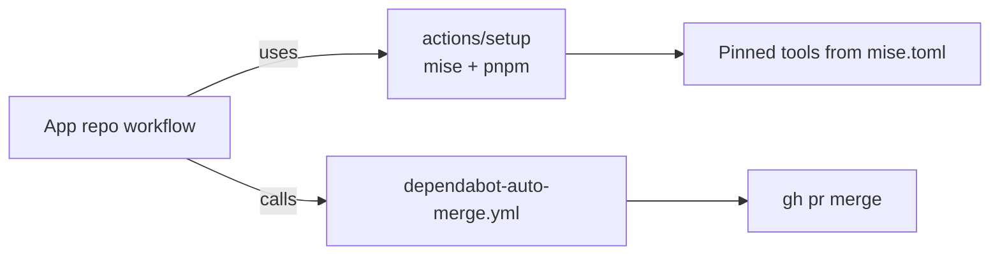

# Architecture

A composite action and a reusable workflow. App repos call them from their own workflows.

| Part       | Technology                    | Job                                                             |
| ---------- | ----------------------------- | --------------------------------------------------------------- |
| Setup      | GitHub composite action, mise | Same tools in every repo                                        |
| Auto merge | Reusable workflow, `gh` CLI   | Merges Dependabot PRs                                           |
| Lint       | `lint.yml`                    | Checks this repo's own files                                    |
| Release    | `release.yml`, shell          | Tags each push to main that passes Lint and publishes its notes |
