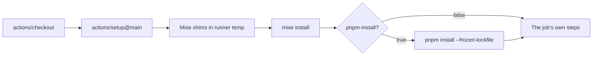
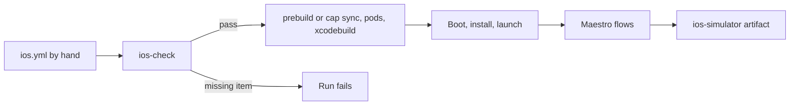
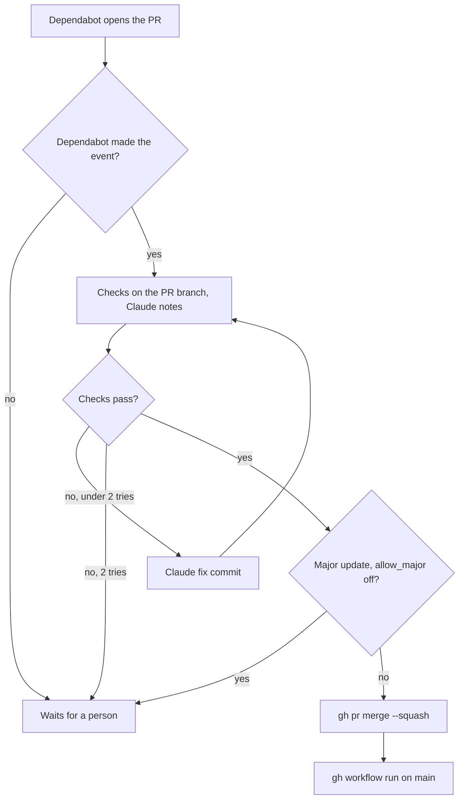
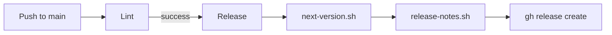

# User flows

Each flow starts in a workflow of an app repo, or in a push to this one, and ends on GitHub.

## Set up the tools in a job

1. A workflow in the app repo checks out the code.
2. The job calls `workbench-soft/ci/actions/setup@main`.
3. The action directs mise shims to the job's temporary directory.
4. `jdx/mise-action` installs the tools `mise.toml` pins, or the ones `install_args` names.
5. `pnpm install --frozen-lockfile` runs, unless `pnpm-install` is `"false"`. On Windows it copies each package from `C:ci_pnpm-store`, and first moves a hardlinked `node_modules` to `_trash-*`.
6. The job's own steps run with those tools.

## Build an app for the iPhone simulator

1. A person or an agent starts the app's `ios.yml`, which calls `ios-simulator.yml`.
2. The `ios-check` job runs `ios-check.ts`. A missing item stops the run.
3. The macOS job makes the iOS project, installs the pods and builds for the simulator.
4. A simulator boots, the app installs and launches, and `launch.png` is taken.
5. Maestro runs the flows under `e2e/maestro/`.
6. The `ios-simulator` artifact uploads, also after a failure.

## Merge a Dependabot PR

1. Dependabot opens or rebases a PR in the app repo.
2. The repo's `dependabot-auto-merge.yml` runs on `pull_request_target`. It starts each file in `workflows` on the PR branch, and Claude writes the notes at the top of the PR body.
3. Each check run that ends calls the shared workflow again through `workflow_run`. It waits while another listed check runs.
4. Red checks start Claude on the PC runner. Its fix commit goes to the branch, and the checks run again. After 2 tries the PR gets `needs-person`.
5. Green checks merge the PR with `gh pr merge --squash`, unless the update is major and `allow_major` is off, or a person pushed to it.
6. `gh workflow run` starts each file in `workflows` on `main`, and each push release workflow that waits on one of them.

## Release this repo

1. A PR merges into `main` with a change beyond Markdown.
2. `Lint` runs on the PC runner. `Release` starts once it passes, and a failed Lint starts no release.
3. `next-version.sh` reads today's tags and prints the next version, such as `2026.10.30.1`.
4. `release-notes.sh` groups the commits since the last tag by type.
5. `gh release create` makes the tag and the release with the notes.

