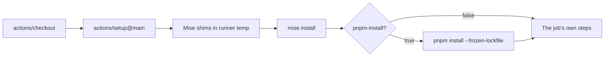
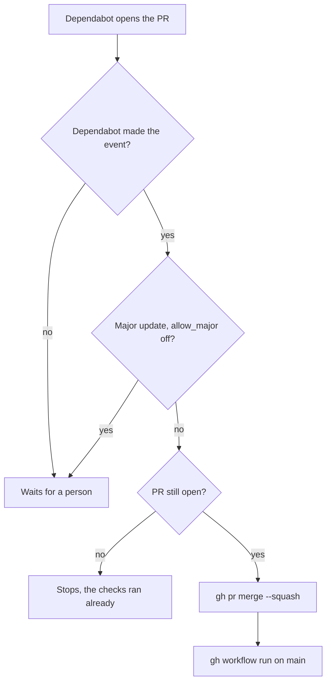
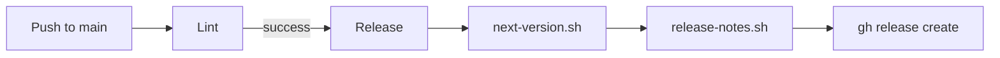

# User flows

Each flow starts in a workflow of an app repo, or in a push to this one, and ends on GitHub.

## Set up the tools in a job

1. A workflow in the app repo checks out the code.
2. The job calls `workbench-soft/ci/actions/setup@main`.
3. The action directs mise shims to the job's temporary directory.
4. `jdx/mise-action` installs the tools `mise.toml` pins, or the ones `install_args` names.
5. `pnpm install --frozen-lockfile` runs, unless `pnpm-install` is `"false"`. On Windows it copies each package from `C:ci_pnpm-store`, and first moves a hardlinked `node_modules` to `_trash-*`.
6. The job's own steps run with those tools.

## Merge a Dependabot PR

1. Dependabot opens or rebases a PR in the app repo.
2. The repo's `dependabot-auto-merge.yml` runs on `pull_request_target` and calls the shared workflow.
3. The job stops when a person made the event, when the update is major and `allow_major` is off, or when the PR is closed already.
4. `gh pr merge --squash --delete-branch` merges the PR.
5. `gh workflow run` starts each file in `workflows` on `main`, and each push release workflow that waits on one of them.

## Release this repo

1. A PR merges into `main` with a change beyond Markdown.
2. `Lint` runs on the PC runner. `Release` starts once it passes, and a failed Lint starts no release.
3. `next-version.sh` reads today's tags and prints the next version, such as `2026.10.30.1`.
4. `release-notes.sh` groups the commits since the last tag by type.
5. `gh release create` makes the tag and the release with the notes.

