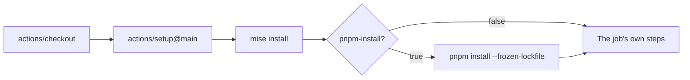
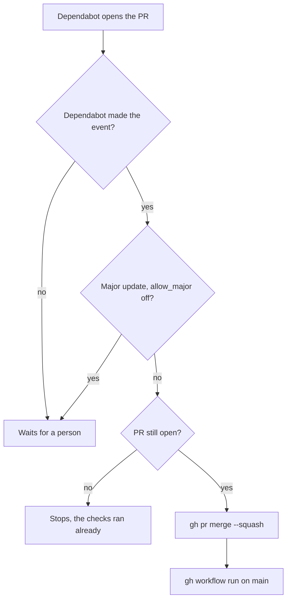
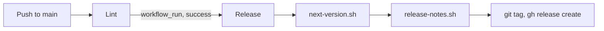

# User flows

Each flow starts in a workflow of an app repo, or in a push to this one, and ends on GitHub.

## Set up the tools in a job

1. A workflow in the app repo checks out the code.
2. The job calls `workbench-soft/ci/actions/setup@main`.
3. `jdx/mise-action` installs the tools `mise.toml` pins, or the ones `install_args` names.
4. `pnpm install --frozen-lockfile` runs, unless `pnpm-install` is `"false"`.
5. The job's own steps run with those tools.

## Merge a Dependabot PR

1. Dependabot opens or rebases a PR in the app repo.
2. The repo's `dependabot-auto-merge.yml` runs on `pull_request_target` and calls the shared workflow.
3. The job stops when a person made the event, when the update is major and `allow_major` is off, or when the PR is closed already.
4. `gh pr merge --squash --delete-branch` merges the PR.
5. `gh workflow run` starts each file in `workflows` on `main`.

## Release this repo

1. A PR merges into `main` with a change beyond Markdown.
2. `Lint` runs `mise run lint` on the PC runner.
3. `Release` starts once `Lint` passes.
4. `next-version.sh` reads today's tags and prints the next version, such as `2026.10.30.1`. A rerun reuses the tag a failed run already pushed.
5. `release-notes.sh` groups the commits since the last tag by type.
6. The job pushes the tag and publishes the release with the notes.

## Release build timing

Release builds start on pushes alongside their matching checks. Publication waits for successful checks of the same commit and branch. Open PRs do not delay the build. LocalCI records the causing run, commit and PR before cancelling a replaced build or a release whose checks failed.
